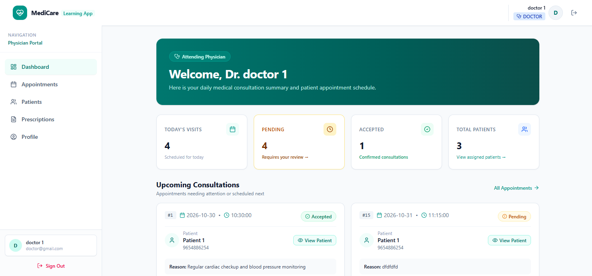

<div align="center">

</div>

# 🏥 MediCore – Healthcare Management System

**MediCore** is a full-stack healthcare management application designed to simplify hospital operations and improve communication between administrators, doctors, and patients.

The application provides role-based access, secure authentication, doctor and patient profile management, appointment scheduling, and prescription management through a responsive and user-friendly interface.

## 🌐 Live Demo

🔗 **Live Application:** [MediCore](https://medi-core-vert.vercel.app/)

## ✨ Features

### 🔐 Authentication & Authorization
- Secure user registration and login.
- JWT-based authentication.
- Role-based access control using Spring Security.
- Protected REST APIs.
- Separate access permissions for Admin, Doctor, and Patient roles.

### 👨‍💼 Admin Dashboard
- Manage doctors and patients.
- View and manage appointments.
- Access healthcare management information.
- Manage application users.

### 👨‍⚕️ Doctor Dashboard
- Manage doctor profiles.
- View assigned appointments.
- Access patient information.
- Manage appointment statuses.
- Create and manage patient prescriptions.

### 🧑‍🤝‍🧑 Patient Dashboard
- Manage personal profiles.
- Browse doctor information.
- Book appointments with doctors.
- View appointment details and status.
- Access prescriptions.

### 📅 Appointment Management
- Schedule appointments between doctors and patients.
- Manage appointment dates and time slots.
- Track appointment statuses.
- Maintain doctor-patient appointment relationships.
- Prevent duplicate appointments using database constraints.

### 💊 Prescription Management
- Create prescriptions for patients.
- Associate prescriptions with appointments.
- Manage prescribed medicines and prescription details.
- Maintain relationships between doctors, patients, and appointments.

## 🛠️ Tech Stack

### Frontend
- React.js
- JavaScript
- Tailwind CSS
- Axios
- React Router
- Context API
- Lucide React

### Backend
- Java
- Spring Boot
- Spring Security
- Spring Data JPA
- Hibernate
- RESTful APIs
- JWT Authentication

### Database
- MySQL

### Tools & Deployment
- Git & GitHub
- Postman
- Maven
- Vercel (Frontend)
- Render (Server)
- Railway (Database)

## 🏗️ Application Architecture

MediCore follows a layered architecture to maintain separation of concerns, improve maintainability, and make the application easier to extend.

```text
              React Frontend
                    |
                    |
              Axios / HTTP
                    |
                    |
             REST Controllers
                    |
                    |
              Service Layer
                    |
                    |
             Repository Layer
                    |
                    |
                MySQL DB
```

### Backend Architecture

The backend follows a layered structure:

- **Controller Layer:** Handles HTTP requests and responses.
- **Service Layer:** Contains business logic and application operations.
- **Repository Layer:** Handles database operations using Spring Data JPA.
- **Entity Layer:** Defines database entities and relationships.
- **DTO Layer:** Transfers data between frontend and backend.
- **Security Layer:** Handles JWT authentication and role-based authorization.
- **Exception Layer:** Handles application exceptions and provides consistent API error responses.

## 👥 User Roles

| Role | Permissions |
|---|---|
| ADMIN | Manage doctors, patients, and appointments |
| DOCTOR | Manage profile, appointments, and prescriptions |
| PATIENT | Manage profile, book appointments, and view prescriptions |

## 🗄️ Database Relationships

The application uses MySQL with Hibernate/JPA to manage relational data.

Major entities include:

- **User:** Stores authentication details and user roles.
- **DoctorProfile:** Stores doctor-specific information.
- **PatientProfile:** Stores patient-specific information.
- **Appointment:** Maintains appointment details and doctor-patient relationships.
- **Prescription:** Stores prescription information associated with appointments.

The application uses JPA relationships such as `@OneToOne`, `@ManyToOne`, and `@OneToMany` to maintain entity relationships.

## 🚀 Getting Started

Follow these instructions to run the project locally.

### Prerequisites

Make sure you have installed:

- Java 17 or later (matching the backend configuration)
- Node.js and npm
- MySQL
- Git
- Maven

### 1. Clone the Repository

```bash
git clone https://github.com/priyanshoe/MediCore
```

Navigate to the frontend directory:

```bash
cd Medicore
```

### 2. Install Frontend Dependencies

```bash
npm install
```

### 3. Configure Frontend Environment Variables

Create a `.env` file in the frontend root directory.

```env
VITE_API_URL=http://localhost:8080/api
```

Update the API URL according to your backend configuration.

### 4. Run the Frontend

```bash
npm run dev
```

Open the application in your browser:

```text
http://localhost:5173
```

### 5. Backend Setup

📂 Refer backend GitHub Repository: [Backend Repo] (https://github.com/priyanshoe/Medicore-backend)

## 🔒 Security

MediCore implements application-level security using Spring Security and JWT.

- Stateless authentication using JWT tokens.
- Password-based authentication.
- Role-based endpoint authorization.
- Protected frontend routes.
- Secure access to role-specific resources.
- Separation of authentication and user profile information.

## 📌 Key Learning Outcomes

Through this project, I gained practical experience in:

- Building full-stack applications using React and Spring Boot.
- Designing RESTful APIs.
- Implementing JWT authentication and Spring Security.
- Managing user roles and permissions.
- Designing relational database schemas.
- Implementing entity relationships using Hibernate/JPA.
- Working with DTOs and service-layer architecture.
- Handling exceptions and API responses.
- Integrating frontend applications with backend APIs.
- Managing application state and API requests.

## 🔮 Future Enhancements

- Online payment integration.
- Email and SMS appointment notifications.
- Doctor availability and calendar management.
- Medical report uploads and management.
- Advanced analytics and reporting.
- Video consultation functionality.

## 👨‍💻 Developer

**Priyanshu Rahate**

Full Stack Java Developer | BCA Graduate

- GitHub: [@priyanshoe](https://github.com/priyanshoe)
- LinkedIn: [im-priyanshu-rahate](https://www.linkedin.com/in/im-priyanshu-rahate/)
- Portfolio: [Priyanshu Rahate](https://priyanshoe.vercel.app/)

---

⭐ If you find this project useful, consider giving it a star!

**Built with ❤️⌚ using React.js, Java, Spring Boot, Spring Security, and MySQL.**